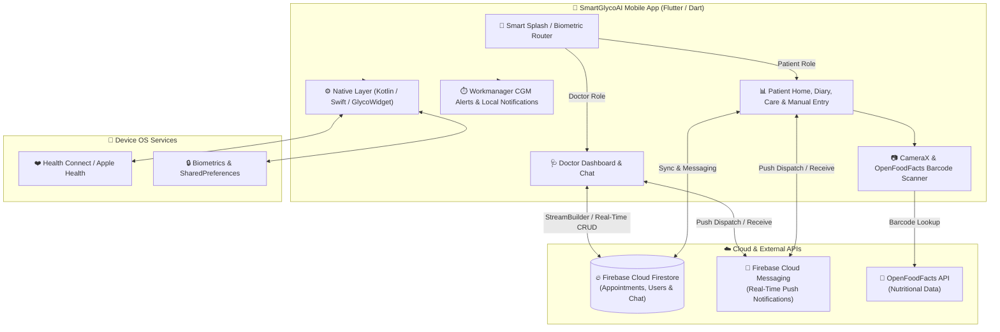
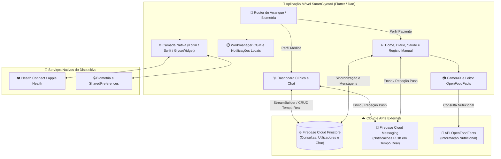

<div align="center">

# 🧬 SmartGlycoAI 📱

**Cross-Platform Clinical Decision Support & Type 1 Diabetes Management Application**  
*Aplicação Multiplataforma de Apoio à Decisão Clínica e Gestão da Diabetes Tipo 1*

<p>
  <a href="https://smartglycoai.vercel.app/">
    
  </a>
  
  
  
  
  
  
  <a href="./LICENSE.md">
    
  </a>
</p>

<p>
  <b>🌐 Language / Idioma:</b><br/>
  <a href="#english"><b> English Version</b></a> &nbsp;|&nbsp; <a href="#portugues"><b>🇵🇹 Versão em Português</b></a>
</p>

</div>

---

<a id="english"></a>
##  English Documentation

### 📖 Table of Contents
1. [Project Overview & Vision](#en-overview)
2. [Core Features & Modules](#en-features)
3. [Test Accounts & Evaluation Walkthrough](#en-test-accounts)
4. [System Architecture & Data Flow](#en-architecture)
5. [Firebase Cloud Firestore Schema](#en-database)
6. [Tech Stack & Build Compatibility Matrix](#en-tech-stack)
7. [Repository Structure](#en-structure)
8. [Prerequisites & Environment Setup](#en-prerequisites)
9. [Build, Run & Physical Device Deployment](#en-build-run)
10. [Troubleshooting Guide](#en-troubleshooting)
11. [Roadmap & Future Work](#en-roadmap)
12. [Academic Context, License & Medical Disclaimer](#en-disclaimer)

---

<a id="en-overview"></a>
### 🎯 1. Project Overview & Vision

**SmartGlycoAI** is a cross-platform mobile application built with **Flutter** designed to modernize **Type 1 Diabetes** self-management and doctor–patient collaboration. Managing Type 1 Diabetes requires continuous synchronization between glycemic trends, carbohydrate estimation, insulin therapy adjustments, proactive safety alerts, and clinical follow-up.

SmartGlycoAI bridges this gap through a unified, role-based ecosystem:
- **For Patients:** Streamlines daily glucose tracking, multi-timeframe analytics, context-aware insulin bolus logging with safety thresholds, barcode nutritional lookup, meal photo capture, predictive hypoglycemia alerts, and direct clinical messaging.
- **For Healthcare Professionals:** Provides a real-time clinical dashboard synced with **Firebase Cloud Firestore** and **Firebase Cloud Messaging (FCM)** to monitor patients, reschedule appointments instantaneously, and send push notifications.

🌐 **Companion Web Portal:** [https://smartglycoai.vercel.app/](https://smartglycoai.vercel.app/)

---

<a id="en-features"></a>
### ✨ 2. Core Features & Modules

#### 🔐 Role-Based Access Control (RBAC) & Smart Startup Routing
- Smart `SplashScreen` startup router checking persisted session state (`isLoggedIn`, `currentUserId`) and biometric lock preferences before routing to **LockScreen**, **Doctor Dashboard**, **Patient Workspace**, or **Login/Onboarding**.
- Supports simulated multi-role authentication, quick-login aliases, Sign Up flow, and Google Sign-In UI flow.

#### 🩺 Clinical Module (Doctor View)
- **Real-Time Appointment Management:** Powered by Cloud Firestore `StreamBuilder`, reflecting schedule updates instantaneously across clients.
- **Interactive Rescheduling Bottom Sheet:** Allows doctors to select new dates and time slots with immediate cloud persistence (`date` and `time` updates) and visual feedback via top snackbar notifications.
- **Patient Overview & Clinical Follow-Up:** Quick access to patient summaries, consultation status (`isCompleted`), and consultation type.
- **Real-Time Clinical Chat & Push Notifications:** Dedicated messaging channel with bidirectional **FCM push notifications** (foreground banners and background/closed-app alerts).

#### 📊 Patient Module, Bolus Safety & Analytics
- **Multi-Timeframe Glucose Charts:** Dedicated interactive chart views supporting **1-Day**, **3-Day**, and **1-Month** glycemic trend analysis with active insulin (**IOB**) tracking.
- **Smart Manual Logging (`ManualEntryScreen`):**
  - Supports **Meal** and **Correction** entries.
  - **Context-Aware Insulin Adjustment:** Automatic bolus recalculation using contextual tags — **🤒 Sick / 😤 Stress (`+20%`)** and **🏋️ Post-Workout / 🏃 Active (`-20%`)**.
  - **High-Dose Safety Guard:** Triggers double heavy haptic feedback and a high-visibility confirmation alert for doses **≥ 15.0 U** to prevent accidental severe hypoglycemia.
- **Predictive Hypoglycemia Alerts (CGM):**
  - Background periodic CGM task (`workmanager`, every 15 minutes) that triggers actionable local notifications (**"🧃 Log 15g Juice"**) when simulated glucose drops below `70 mg/dL`.
  - One-tap in-app alert simulation accessible via the top-bar bell icon.

#### 📷 Computer Vision & Nutritional Scanning
- **Meal Photo Capture:** Native Android CameraX integration (`camera_android_camerax`) with proper lifecycle management (`init`/`dispose`) for meal capture and carbohydrate estimation workflows.
- **Barcode Scanner:** Fast nutritional product scanning (`mobile_scanner`) integrated directly with the **OpenFoodFacts API**, auto-filling product name, carbohydrates per 100g, and recalculated insulin dose.

#### ♿ Accessibility, Localization & Native OS Integrations
- **Instant Bilingual Support (`PT / EN`):** Real-time language switching between Portuguese and English from the login screen or Profile tab.
- **High-Contrast Accessibility Mode:** Dedicated black-and-yellow high-contrast UI theme toggleable in *Profile* for visually impaired users.
- **Health Data Aggregation:** Integration with **Android Health Connect** and **Apple Health** via the `health` plugin.
- **Biometric Security:** Local device authentication (`local_auth`) for Fingerprint / Face ID app lock.
- **Home Screen Widgets & Background Services:** iOS/Android widgets (`GlycoWidget` / `home_widget`), local notifications (`flutter_local_notifications`), runtime permissions (`permission_handler`), and local persistence (`shared_preferences`).

---

<a id="en-test-accounts"></a>
### 🔑 3. Test Accounts & Evaluation Walkthrough

To facilitate testing, heuristic evaluation (IPM Stage 5), and RBAC demonstration, the app includes pre-configured demo accounts. All accounts share the same password (`1234`):

| Role | Full Name | Email | Quick Login Alias | Password | Routed Interface |
| :--- | :--- | :--- | :--- | :--- | :--- |
| **Doctor** | Dra. Joana Silvia | `joana@smartglyco.pt` | `medica` | `1234` | Clinical Dashboard (`doctor_dashboard.dart`) |
| **Patient** | João Antunes | `joao@smartglyco.pt` | `joao` | `1234` | Patient Workspace (`MainNavigator`) |
| **Patient** | Maria Silva | `maria@smartglyco.pt` | `maria` | `1234` | Patient Workspace (`MainNavigator`) |

#### 🧪 Suggested Evaluation & QA Test Scenarios
1. **Test Doctor Real-Time Cloud Sync & Notifications:**
   - Log in with `medica` (or `joana@smartglyco.pt`) and password `1234`.
   - Open the appointments list showing **João Antunes** and **Maria Silva** fetched live from Cloud Firestore.
   - Tap an appointment card to open the rescheduling Bottom Sheet, choose a new date and time, and tap **Confirm Appointment**.
   - Verify the confirmation banner appears and the updated `date` / `time` reflects immediately in the UI and Firebase Console.
2. **Test Patient Dashboard, Charts & Predictive Alerts:**
   - Log in with `joao` (or `maria`) and password `1234`.
   - Inspect the **Home** dashboard and tap the **bell icon** (top right) to trigger a simulated **Predictive Hypoglycemia Alert**.
   - Explore the **1-Day / 3-Day / 1-Month** glucose charts and **Diary / Care / Chat** tabs.
3. **Test Smart Manual Logging, Barcode & Safety Guard:**
   - Tap the **`+`** button (bottom right) and open **Manual Log** (or **Analyze Meal**).
   - Enter carbs (e.g., `60 g`), toggle **Sick / Stress** (`+20%`) or **Post-Workout** (`-20%`), and observe live insulin recalculation.
   - Enter a dose `>= 15 U` and tap **Save Log** to verify the haptic **Safety Alert** confirmation dialog.
   - Test the barcode scanner icon against any packaged food product (OpenFoodFacts lookup).
4. **Test Accessibility & Localization:**
   - Switch between **PT / EN** (top bar or *Profile*) and toggle **High-Contrast Mode** in *Profile* to evaluate visual accessibility across screens.

> **Note:** These demo credentials are intentionally documented in this repository exclusively for academic evaluation, heuristic inspection, and QA.

---

<a id="en-architecture"></a>
### 🏗️ 4. System Architecture & Data Flow



---

<a id="en-database"></a>
### 🔥 5. Firebase Cloud Firestore Schema

#### Collection: `appointments`
Stores real-time clinical consultation records synced directly with `doctor_dashboard.dart`.

**Document IDs:** `joao_antunes`, `maria_silva`

```json
{
  "patientName": "João Antunes",
  "initials": "JA",
  "date": "17/11/2026",
  "time": "9:30 AM",
  "type": "Revisão Mensal (Remarcada)",
  "isCompleted": false
}
```

| Field | Data Type | Format / Example | Description |
| :--- | :--- | :--- | :--- |
| `patientName` | `string` | `"João Antunes"` | Full display name of the patient |
| `initials` | `string` | `"JA"` | Avatar badge initials |
| `date` | `string` | `"17/11/2026"` | Scheduled date formatted as `DD/MM/YYYY` |
| `time` | `string` | `"9:30 AM"` | Scheduled consultation time slot |
| `type` | `string` | `"Ajuste de Insulina"` | Clinical reason / appointment category |
| `isCompleted` | `boolean` | `false` | Completion status flag |

#### Collection: `users`
Stores active device push tokens registered automatically by `FcmNotificationService` upon login.

**Document IDs:** `medica_joana`, `paciente_joao`, `paciente_maria`

```json
{
  "fcmToken": "eXy9...device_token...",
  "name": "João Antunes",
  "updatedAt": "FieldValue.serverTimestamp()"
}
```

#### Subcollection: `chats/{patientId}/messages`
Structured for persistent bidirectional real-time messaging between doctor and patient:
- `senderId` (`string`), `senderRole` (`"doctor"` | `"patient"`), `text` (`string`), `timestamp` (`FieldValue.serverTimestamp()`).

---

<a id="en-tech-stack"></a>
### 🛠️ 6. Tech Stack & Build Compatibility Matrix

| Layer | Technology / Specification | Version / Target |
| :--- | :--- | :--- |
| **UI Framework** | Flutter | Latest Stable |
| **Primary Language** | Dart | 3.x |
| **Android Native** | Kotlin + Kotlin DSL (`.kts`) | Kotlin `2.4.x` |
| **iOS Native** | Swift + CocoaPods / Xcode | iOS 13+ |
| **Cloud Backend** | Firebase Core, Cloud Firestore & FCM | Real-Time NoSQL & Push v1 |
| **Java Runtime (Build)** | OpenJDK / Oracle JDK | **JDK 21** (`jvmToolchain(21)`) |
| **Gradle Wrapper** | Gradle | **9.5.0** |
| **Android Gradle Plugin** | AGP | **9.1.1+** (recommended `9.3.1`) |
| **Android SDK Targets** | `compileSdk` / `targetSdk` / `minSdk` | **36** / **36** / **26** |
| **Desugaring** | `com.android.tools:desugar_jdk_libs` | **2.1.5** |
| **Android Package ID** | `applicationId` / `namespace` | `com.example.smart_glyco_ai` |
| **iOS Bundle ID** | `PRODUCT_BUNDLE_IDENTIFIER` | `com.example.smartGlycoAi` |

> **Why `minSdk = 26` and `compileSdk = 36`?**  
> The `health` plugin strictly requires Android API 26 (Android 8.0) as the minimum SDK, while modern Flutter plugins (`camera_android_camerax`, `mobile_scanner`, `local_auth_android`, `device_info_plus`, `share_plus`, etc.) require compiling against Android SDK 36.

---

<a id="en-structure"></a>
### 📂 7. Repository Structure

```text
IPM-6-APP/
├── lib/                                # Core Flutter / Dart source code
│   ├── main.dart                       # App entry point, Firebase & Workmanager init
│   ├── app_data.dart                   # Global state, localization (PT/EN) & persistence
│   ├── fcm_notification_service.dart   # FCM push notifications & token registration
│   ├── startup_screens.dart            # Splash router, Onboarding, Login & Biometric Lock
│   ├── main_navigator.dart             # Bottom navigation shell & Speed Dial
│   └── screens/                        # Role-based UI screens
│       ├── doctor_dashboard.dart       # Real-time Firestore clinical dashboard
│       ├── doctor_chat_screen.dart     # Clinical messaging interface
│       ├── manual_entry_screen.dart    # Bolus tags, safety alert & barcode scanner
│       └── ...                         # Patient Home, Charts, Diary, Care, Profile
├── android/                            # Android Native Module (Kotlin DSL)
│   ├── app/
│   │   ├── build.gradle.kts            # SDK 36, minSdk 26, JDK 21, Desugaring
│   │   ├── google-services.json        # Firebase Android config
│   │   └── src/
│   │       ├── debug/AndroidManifest.xml
│   │       ├── main/
│   │       │   ├── AndroidManifest.xml # Hardware, Camera & Health permissions
│   │       │   ├── kotlin/.../MainActivity.kt
│   │       │   └── res/                # Drawables, Mipmaps, Night/v31 Styles
│   │       └── profile/AndroidManifest.xml
│   ├── gradle/wrapper/
│   │   └── gradle-wrapper.properties   # Gradle 9.5.0 distribution URL
│   ├── build.gradle.kts                # Root Gradle build script
│   └── settings.gradle(.kts)           # Flutter plugin loader, AGP & KGP
├── ios/                                # iOS Native Module (Xcode / Swift)
│   ├── GlycoWidget/                    # iOS Home Screen Widget extension
│   ├── Runner.xcodeproj / .xcworkspace # Xcode project & CocoaPods workspace
│   ├── Runner/
│   │   ├── AppDelegate.swift           # Swift lifecycle entry point
│   │   ├── SceneDelegate.swift         # iOS Scene lifecycle handler
│   │   ├── Assets.xcassets/            # AppIcons (20px–1024px) & LaunchImages
│   │   └── GoogleService-Info.plist    # Firebase iOS config (Target: Runner)
│   └── Flutter/                        # Debug.xcconfig, Release.xcconfig
├── analysis_options.yaml               # Strict Dart static analysis & linting
├── devtools_options.yaml               # Flutter DevTools profiling config
├── pubspec.yaml                        # Dart dependencies & asset registry
├── LICENSE.md                          # Proprietary Academic Evaluation License
└── README.md                           # Project documentation
```

---

<a id="en-prerequisites"></a>
### ⚙️ 8. Prerequisites & Environment Setup

Before building the project locally, ensure your development machine meets the following requirements:

1. **Flutter SDK:** Installed and verified via `flutter doctor` with no critical errors.
2. **Java Development Kit (JDK 21):** Required to match `jvmToolchain(21)` and Gradle 9.5.0.
   - Verify or explicitly point Flutter to JDK 21:
     ```bash
     flutter config --jdk-dir="C:\Program Files\Java\jdk-21.0.12"
     ```
3. **Android Studio & SDKs:**
   - Install **Android SDK Platform 36** and Android SDK Build-Tools.
   - Use an Android Emulator or physical device running **Android 8.0 (API 26) or higher**.
4. **Xcode (macOS only):** Required for iOS compilation, CocoaPods (`pod install`), and device signing.
5. **Firebase Configuration Files:**
   - Ensure `android/app/google-services.json` (Android) and `ios/Runner/GoogleService-Info.plist` (iOS, registered under the `Runner` target in Xcode) are present.
   - *(Security Note)* `assets/service_account.json` is excluded from version control via `.gitignore`. All core app features work without it; it is only required locally if testing direct client-side FCM v1 push dispatch.

---

<a id="en-build-run"></a>
### 🚀 9. Build, Run & Physical Device Deployment

Run these commands from the **root directory** of the project:

```bash
# 1. Clean previous build artifacts (recommended after config changes)
flutter clean

# 2. Fetch all Flutter & Dart dependencies
flutter pub get

# 3. Run in debug mode on a connected emulator or physical device
flutter run

# 4. Build a Debug APK (fast build for direct device testing)
flutter build apk --debug

# 5. Build an optimized Release APK (ready for distribution / evaluation)
flutter build apk --release

# 6. Build a Release IPA for iOS (macOS only)
flutter build ipa --release
```

📦 **Output APK Path:** `build/app/outputs/flutter-apk/app-release.apk` (or `app-debug.apk`).

#### 📱 Deploying to a Physical Android Device (e.g., Xiaomi / MIUI / HyperOS)
1. Enable **Developer Options** (*Settings → About Phone → Tap OS/MIUI Version 7 times*).
2. Enable **USB Debugging** and **Install via USB** (*Note: On Xiaomi devices, disable "Verify apps over USB" or enable "USB Debugging (Security settings)" to prevent `INSTALL_FAILED_USER_RESTRICTED`*).
3. Connect via USB, verify detection with `flutter devices`, and run `flutter run` (or transfer the generated `.apk` manually).

#### 🍏 Deploying to a Physical iPhone (macOS + Xcode)
1. Open **`ios/Runner.xcworkspace`** in Xcode (do not open `.xcodeproj`).
2. Select the **Runner** target → **Signing & Capabilities** → select your **Apple ID Team**.
3. Ensure **`GoogleService-Info.plist`** appears inside the **Runner** folder in Xcode with **Target Membership → Runner** checked.
4. On the iPhone, enable **Developer Mode** (*Settings → Privacy & Security → Developer Mode*).
5. Run `flutter run` from the project root and trust the developer certificate under *Settings → General → VPN & Device Management*.

---

<a id="en-troubleshooting"></a>
### 🩹 10. Troubleshooting Guide

| Issue / Error Message | Root Cause | Solution |
| :--- | :--- | :--- |
| `[core/no-app] No Firebase App '[DEFAULT]' has been created` (iOS — e.g., when opening **Care**) | `GoogleService-Info.plist` is missing from the Xcode `Runner` target or its `BUNDLE_ID` does not match `com.example.smartGlycoAi`. | Open `ios/Runner.xcworkspace` in Xcode → right-click **Runner** → **Add Files to "Runner"...** → add `ios/Runner/GoogleService-Info.plist` with target **Runner** checked → run `flutter clean && flutter pub get && flutter run`. |
| Black screen on Android Emulator (`sdk gphone16k x86_64` / `Width is zero`) | Impeller OpenGLES backend incompatibility on some x86_64 Android emulators. | Run with Skia fallback: `flutter run --no-enable-impeller`. |
| `Java version 25.x is incompatible with Gradle` or `Cannot find Java installation matching languageVersion=21` | System `JAVA_HOME` points to an unsupported JDK version. | Point Flutter explicitly to JDK 21: `flutter config --jdk-dir="<path-to-jdk-21>"` and run `flutter clean`. |
| `Timeout waiting to lock build logic queue (buildLogic.lock)` | A previous Gradle daemon hung and kept the lock file open. | Stop stuck daemons: `cd android && ./gradlew --stop && cd ..` then re-run. |
| `Manifest merger failed: minSdkVersion cannot be smaller than 26 declared in [:health]` | `minSdk` in `android/app/build.gradle.kts` is set below 26. | Set `minSdk = 26` inside `defaultConfig` in `android/app/build.gradle.kts`. |
| `Missing local.properties` / Red import underlines in IDE | Dependencies not fetched or SDK path not regenerated after clone. | Run `flutter pub get` and restart the Dart Analysis Server. |
| `Warning: Your app uses plugins that apply Kotlin Gradle Plugin (KGP)` | Upstream third-party Flutter plugins haven't migrated to Built-in Kotlin yet. | Non-blocking warning. Safe to ignore until plugin maintainers release updates (`flutter pub upgrade`). |

---

<a id="en-roadmap"></a>
### 🗺️ 11. Roadmap & Future Work

- [x] Role-Based Access Control (Doctor & Patient flows) & Smart Startup Router
- [x] Interactive Glucose Analytics (1D / 3D / 1M views) & IOB Overview
- [x] CameraX Meal Capture & OpenFoodFacts Barcode Scanner
- [x] Context-Aware Bolus Adjustment Tags & High-Dose (`>= 15 U`) Haptic Safety Alert
- [x] Predictive Hypoglycemia CGM Alerts (`workmanager` + actionable local notifications)
- [x] Bilingual Interface (`PT / EN`) & High-Contrast Accessibility Mode
- [x] Firebase Cloud Firestore Real-Time Appointments & FCM Push Notifications
- [x] Android SDK 36 / Gradle 9.5.0 / JDK 21 Modernization
- [ ] Bluetooth CGM (Continuous Glucose Monitor) Live Hardware Streaming Integration
- [ ] On-Device Computer Vision ML Model for Automated Carbohydrate & Bolus Estimation
- [ ] Production Firebase Authentication & Granular Firestore Security Rules

---

<a id="en-disclaimer"></a>
### 🎓 12. Academic Context, License & Medical Disclaimer

Developed by **Group 6** as part of the **Human-Computer Interaction (IPM 2026/2027)** course at **NOVA School of Science and Technology (NOVA FCT)**.

- **License:** Distributed exclusively under the **Proprietary Academic Evaluation License** — see [`LICENSE.md`](./LICENSE.md) for full terms, restrictions, and evaluation rights.

> ⚠️ **Medical Disclaimer:** SmartGlycoAI is an academic research and software engineering prototype. It is **not a certified medical device** and must **not** be used for real-world clinical diagnosis, insulin dosing, or medical treatment decisions.

---
---

<a id="portugues"></a>
## 🇵🇹 Documentação em Português

### 📖 Índice
1. [Visão Geral do Projeto](#pt-overview)
2. [Funcionalidades e Módulos Principais](#pt-features)
3. [Contas de Teste e Guião de Avaliação (QA)](#pt-test-accounts)
4. [Arquitetura do Sistema e Fluxo de Dados](#pt-architecture)
5. [Esquema da Base de Dados (Cloud Firestore)](#pt-database)
6. [Stack Tecnológica e Matriz de Compatibilidade](#pt-tech-stack)
7. [Estrutura do Repositório](#pt-structure)
8. [Pré-requisitos e Configuração do Ambiente](#pt-prerequisites)
9. [Compilação, Execução e Instalação em Dispositivos](#pt-build-run)
10. [Guia de Resolução de Problemas (Troubleshooting)](#pt-troubleshooting)
11. [Roadmap e Trabalho Futuro](#pt-roadmap)
12. [Contexto Académico, Licença e Aviso Médico](#pt-disclaimer)

---

<a id="pt-overview"></a>
### 🎯 1. Visão Geral do Projeto

A **SmartGlycoAI** é uma aplicação móvel multiplataforma desenvolvida em **Flutter**, concebida para modernizar a autogestão da **Diabetes Tipo 1** e a colaboração em tempo real entre doentes e profissionais de saúde. A gestão da Diabetes Tipo 1 exige monitorização contínua da glicemia, estimativa rigorosa de hidratos de carbono, ajustes de terapêutica de insulina, alertas de segurança proativos e acompanhamento clínico constante.

A aplicação responde a este desafio através de um ecossistema unificado baseado em perfis:
- **Para Pacientes:** Simplifica o registo diário de glicemia, análise gráfica por múltiplos períodos, registo de insulina sensível ao contexto com alertas de segurança, leitura nutricional por código de barras, captura fotográfica de refeições, alertas preditivos de hipoglicemia e contacto direto com a equipa médica.
- **Para Profissionais de Saúde:** Disponibiliza um painel clínico sincronizado em tempo real com o **Firebase Cloud Firestore** e **Firebase Cloud Messaging (FCM)** para gerir consultas, remarcar datas/horas instantaneamente e enviar notificações push.

🌐 **Portal Web do Projeto:** [https://smartglycoai.vercel.app/](https://smartglycoai.vercel.app/)

---

<a id="pt-features"></a>
### ✨ 2. Funcionalidades e Módulos Principais

#### 🔐 Controlo de Acesso Baseado em Funções (RBAC) e Arranque Inteligente
- Router inteligente no `SplashScreen` que verifica o estado de sessão guardado (`isLoggedIn`, `currentUserId`) e a proteção biométrica antes de encaminhar para o **LockScreen**, **Dashboard da Médica**, **Área do Paciente** ou **Login/Onboarding**.
- Suporta autenticação simulada multiperfil, atalhos rápidos de login, fluxo de criação de conta (*Sign Up*) e entrada via Google.

#### 🩺 Módulo Clínico (Vista da Médica)
- **Gestão de Consultas em Tempo Real:** Alimentada por `StreamBuilder` ligado ao Cloud Firestore, refletindo alterações de agenda instantaneamente.
- **Remarcação Interativa (Bottom Sheet):** Permite selecionar novas datas e horários com gravação imediata na nuvem (atualização simultânea dos campos `date` e `time`) e confirmação visual via *Top SnackBar*.
- **Vista Geral de Pacientes:** Acesso rápido ao resumo de cada doente, tipo de consulta e estado de conclusão (`isCompleted`).
- **Chat Clínico e Notificações Push em Tempo Real:** Canal dedicado entre médica e paciente com envio de **notificações push FCM** (em primeiro plano e com a aplicação fechada).

#### 📊 Módulo do Paciente, Segurança de Bólus e Análise Glicémica
- **Gráficos Interativos de Glicemia:** Ecrã dedicado com visualização de tendências para **1 Dia**, **3 Dias** e **1 Mês** e acompanhamento de insulina ativa (**IOB**).
- **Registo Manual Inteligente (`ManualEntryScreen`):**
  - Suporta registos de **Refeição** e **Correção**.
  - **Ajuste Automático por Etiquetas de Contexto:** Recalcula a dose de insulina automaticamente consoante o contexto — **🤒 Doente / 😤 Stress (`+20%`)** e **🏋️ Pós-Treino / 🏃 Ativo (`-20%`)**.
  - **Alerta de Segurança para Doses Elevadas:** Dispara feedback háptico duplo e um diálogo de confirmação de alto impacto para doses **≥ 15.0 U**, prevenindo hipoglicemias severas acidentais.
- **Alertas Preditivos de Hipoglicemia (CGM):**
  - Tarefa periódica em segundo plano (`workmanager`, a cada 15 minutos) que lança notificações locais acionáveis (**"🧃 Registar 15g Sumo"**) quando a glicose simulada desce abaixo de `70 mg/dL`.
  - Simulação imediata do alerta dentro da app através do ícone do sino na barra superior.

#### 📷 Visão Computacional e Leitura Nutricional
- **Captura de Refeições:** Integração nativa com Android CameraX (`camera_android_camerax`) com gestão controlada do ciclo de vida do controlador (`init`/`dispose`) para captura fotográfica de refeições.
- **Leitor de Códigos de Barras:** Leitura rápida de embalagens (`mobile_scanner`) integrada com a API **OpenFoodFacts**, preenchendo automaticamente o nome do alimento, os hidratos por 100g e a dose de insulina recalculada.

#### ♿ Acessibilidade, Idioma e Integrações Nativas
- **Alternância Instantânea de Idioma (`PT / EN`):** Mudança imediata entre Português e Inglês no ecrã de login ou no separador *Perfil*.
- **Modo de Alto Contraste:** Tema de acessibilidade dedicado (preto e amarelo de alto contraste) ativável no *Perfil* para utilizadores com baixa visão.
- **Dados de Saúde:** Integração com **Android Health Connect** e **Apple Health** através do plugin `health`.
- **Segurança Biométrica:** Autenticação nativa no dispositivo (`local_auth`) via impressão digital ou Face ID.
- **Widgets e Serviços de Sistema:** Widgets no ecrã inicial (`GlycoWidget` / `home_widget`), notificações locais (`flutter_local_notifications`), gestão de permissões (`permission_handler`) e armazenamento local (`shared_preferences`).

---

<a id="pt-test-accounts"></a>
### 🔑 3. Contas de Teste e Guião de Avaliação (QA)

Para facilitar os testes, a avaliação heurística (Fase 5 de IPM) e a demonstração do sistema RBAC, a aplicação inclui contas de demonstração pré-configuradas. Todas utilizam a mesma palavra-passe (`1234`):

| Perfil | Nome Completo | Email | Atalho de Login | Password | Interface de Destino |
| :--- | :--- | :--- | :--- | :--- | :--- |
| **Médica** | Dra. Joana Silvia | `joana@smartglyco.pt` | `medica` | `1234` | Dashboard Clínico (`doctor_dashboard.dart`) |
| **Paciente** | João Antunes | `joao@smartglyco.pt` | `joao` | `1234` | Área do Paciente (`MainNavigator`) |
| **Paciente** | Maria Silva | `maria@smartglyco.pt` | `maria` | `1234` | Área do Paciente (`MainNavigator`) |

#### 🧪 Cenários de Teste e Avaliação Recomendados
1. **Testar Sincronização em Tempo Real e Notificações (Perfil Médica):**
   - Iniciar sessão com `medica` (ou `joana@smartglyco.pt`) e password `1234`.
   - Confirmar que os cartões das consultas de **João Antunes** e **Maria Silva** carregam diretamente do Cloud Firestore.
   - Tocar num cartão de consulta para abrir o *Bottom Sheet* de remarcação, escolher uma nova data e hora e confirmar em **Confirm Appointment**.
   - Verificar a notificação de confirmação e a atualização imediata dos campos `date` e `time` na interface e na consola do Firebase.
2. **Testar Painel do Paciente, Gráficos e Alertas Preditivos:**
   - Iniciar sessão com `joao` (ou `maria`) e password `1234`.
   - No ecrã **Início (Home)**, tocar no **ícone do sino** (canto superior direito) para simular um **Alerta Preditivo de Hipoglicemia**.
   - Explorar os gráficos de glicemia de **1 Dia / 3 Dias / 1 Mês** e os separadores **Diário / Saúde (Care) / Chat**.
3. **Testar Registo Manual Inteligente, Código de Barras e Alerta de Segurança:**
   - Tocar no botão **`+`** (canto inferior direito) e abrir **Registo Manual** (ou **Analisar Refeição**).
   - Inserir hidratos (ex.: `60 g`), selecionar **Doente / Stress** (`+20%`) ou **Pós-Treino** (`-20%`) e observar o recálculo automático da insulina.
   - Introduzir uma dose `>= 15 U` e carregar em **Guardar Registo** para validar o **Alerta de Segurança** com vibração háptica.
   - Testar o leitor de códigos de barras num produto embalado (consulta OpenFoodFacts).
4. **Testar Acessibilidade e Idioma:**
   - Alternar entre **PT / EN** (barra superior ou *Perfil*) e ativar o **Modo de Alto Contraste** no *Perfil* para avaliar o contraste visual em todos os ecrãs.

> **Nota:** Estas credenciais são disponibilizadas intencionalmente neste repositório exclusivamente para fins de avaliação académica, inspeção heurística e testes de qualidade (QA).

---

<a id="pt-architecture"></a>
### 🏗️ 4. Arquitetura do Sistema e Fluxo de Dados



---

<a id="pt-database"></a>
### 🔥 5. Esquema da Base de Dados (Cloud Firestore)

#### Coleção: `appointments`
Armazena as consultas clínicas em tempo real sincronizadas diretamente com o ficheiro `doctor_dashboard.dart`.

**IDs de Documentos:** `joao_antunes`, `maria_silva`

```json
{
  "patientName": "João Antunes",
  "initials": "JA",
  "date": "17/11/2026",
  "time": "9:30 AM",
  "type": "Revisão Mensal (Remarcada)",
  "isCompleted": false
}
```

| Campo | Tipo de Dados | Formato / Exemplo | Descrição |
| :--- | :--- | :--- | :--- |
| `patientName` | `string` | `"João Antunes"` | Nome completo do paciente |
| `initials` | `string` | `"JA"` | Iniciais apresentadas no avatar |
| `date` | `string` | `"17/11/2026"` | Data agendada no formato `DD/MM/YYYY` |
| `time` | `string` | `"9:30 AM"` | Hora marcada para a consulta |
| `type` | `string` | `"Ajuste de Insulina"` | Motivo clínico / tipologia da consulta |
| `isCompleted` | `boolean` | `false` | Indicador de conclusão da consulta |

#### Coleção: `users`
Armazena os tokens push dos dispositivos registados automaticamente pelo `FcmNotificationService` após o login.

**IDs de Documentos:** `medica_joana`, `paciente_joao`, `paciente_maria`

```json
{
  "fcmToken": "eXy9...token_do_dispositivo...",
  "name": "João Antunes",
  "updatedAt": "FieldValue.serverTimestamp()"
}
```

#### Subcoleção: `chats/{patientId}/messages`
Estruturada para persistência de mensagens bidirecionais em tempo real entre médica e paciente:
- `senderId` (`string`), `senderRole` (`"doctor"` | `"patient"`), `text` (`string`), `timestamp` (`FieldValue.serverTimestamp()`).

---

<a id="pt-tech-stack"></a>
### 🛠️ 6. Stack Tecnológica e Matriz de Compatibilidade

| Camada | Tecnologia / Especificação | Versão / Alvo |
| :--- | :--- | :--- |
| **Framework UI** | Flutter | Última Estável |
| **Linguagem Principal** | Dart | 3.x |
| **Nativo Android** | Kotlin + Kotlin DSL (`.kts`) | Kotlin `2.4.x` |
| **Nativo iOS** | Swift + CocoaPods / Xcode | iOS 13+ |
| **Backend Cloud** | Firebase Core, Cloud Firestore e FCM | NoSQL em Tempo Real e Push v1 |
| **Java Runtime (Build)** | OpenJDK / Oracle JDK | **JDK 21** (`jvmToolchain(21)`) |
| **Gradle Wrapper** | Gradle | **9.5.0** |
| **Android Gradle Plugin** | AGP | **9.1.1+** (recomendado `9.3.1`) |
| **Android SDKs** | `compileSdk` / `targetSdk` / `minSdk` | **36** / **36** / **26** |
| **Desugaring** | `com.android.tools:desugar_jdk_libs` | **2.1.5** |
| **Pacote Android** | `applicationId` / `namespace` | `com.example.smart_glyco_ai` |
| **Bundle ID iOS** | `PRODUCT_BUNDLE_IDENTIFIER` | `com.example.smartGlycoAi` |

> **Porquê `minSdk = 26` e `compileSdk = 36`?**  
> O plugin `health` exige obrigatoriamente a API Android 26 (Android 8.0) como versão mínima, enquanto os plugins mais recentes do ecossistema Flutter (`camera_android_camerax`, `mobile_scanner`, `local_auth_android`, `device_info_plus`, `share_plus`, entre outros) requerem compilação com o Android SDK 36.

---

<a id="pt-structure"></a>
### 📂 7. Estrutura do Repositório

```text
IPM-6-APP/
├── lib/                                # Código-fonte principal Flutter / Dart
│   ├── main.dart                       # Ponto de entrada, Firebase e Workmanager
│   ├── app_data.dart                   # Estado global, tradução (PT/EN) e persistência
│   ├── fcm_notification_service.dart   # Notificações Push FCM e registo de tokens
│   ├── startup_screens.dart            # Router Splash, Onboarding, Login e Biometria
│   ├── main_navigator.dart             # Navegação inferior e botão Speed Dial
│   └── screens/                        # Ecrãs da aplicação por perfil
│       ├── doctor_dashboard.dart       # Dashboard clínico em tempo real (Firestore)
│       ├── doctor_chat_screen.dart     # Interface de chat clínico
│       ├── manual_entry_screen.dart    # Etiquetas de bólus, alerta de segurança e scanner
│       └── ...                         # Home, Gráficos, Diário, Saúde, Perfil
├── android/                            # Módulo Nativo Android (Kotlin DSL)
│   ├── app/
│   │   ├── build.gradle.kts            # SDK 36, minSdk 26, JDK 21, Desugaring
│   │   ├── google-services.json        # Configuração Firebase Android
│   │   └── src/
│   │       ├── debug/AndroidManifest.xml
│   │       ├── main/
│   │       │   ├── AndroidManifest.xml # Permissões de Câmara, Saúde e Hardware
│   │       │   ├── kotlin/.../MainActivity.kt
│   │       │   └── res/                # Drawables, Mipmaps, Estilos Night/v31
│   │       └── profile/AndroidManifest.xml
│   ├── gradle/wrapper/
│   │   └── gradle-wrapper.properties   # URL de distribuição Gradle 9.5.0
│   ├── build.gradle.kts                # Script Gradle raiz
│   └── settings.gradle(.kts)           # Carregador Flutter, AGP e KGP
├── ios/                                # Módulo Nativo iOS (Xcode / Swift)
│   ├── GlycoWidget/                    # Extensão de Widget para ecrã inicial iOS
│   ├── Runner.xcodeproj / .xcworkspace # Projeto Xcode e Workspace CocoaPods
│   ├── Runner/
│   │   ├── AppDelegate.swift           # Ponto de entrada Swift
│   │   ├── SceneDelegate.swift         # Gestão de ciclo de vida Scene iOS
│   │   ├── Assets.xcassets/            # Ícones Apple (20px–1024px) e LaunchImages
│   │   └── GoogleService-Info.plist    # Configuração Firebase iOS (Target: Runner)
│   └── Flutter/                        # Debug.xcconfig, Release.xcconfig
├── analysis_options.yaml               # Regras estritas de análise estática Dart
├── devtools_options.yaml               # Configuração do Flutter DevTools
├── pubspec.yaml                        # Dependências Dart e registo de assets
├── LICENSE.md                          # Licença Proprietária de Avaliação Académica
└── README.md                           # Documentação do projeto
```

---

<a id="pt-prerequisites"></a>
### ⚙️ 8. Pré-requisitos e Configuração do Ambiente

Antes de compilar o projeto localmente, garanta que o ambiente cumpre os seguintes requisitos:

1. **Flutter SDK:** Instalado e validado com `flutter doctor` sem erros críticos.
2. **Java Development Kit (JDK 21):** Obrigatório para compatibilidade com `jvmToolchain(21)` e Gradle 9.5.0.
   - Para associar explicitamente o JDK 21 ao Flutter:
     ```bash
     flutter config --jdk-dir="C:\Program Files\Java\jdk-21.0.12"
     ```
3. **Android Studio e SDKs:**
   - Instalar **Android SDK Platform 36** e Android SDK Build-Tools.
   - Utilizar um emulador ou telemóvel Android com **Android 8.0 (API 26) ou superior**.
4. **Xcode (apenas macOS):** Necessário para compilação iOS, CocoaPods (`pod install`) e assinatura digital.
5. **Ficheiros de Configuração Firebase:**
   - Garantir a presença dos ficheiros `android/app/google-services.json` (Android) e `ios/Runner/GoogleService-Info.plist` (iOS, registado no target `Runner` no Xcode).
   - *(Nota de Segurança)* O ficheiro `assets/service_account.json` está excluído do Git via `.gitignore` por segurança. Todas as funcionalidades principais correm sem ele; só é necessário localmente caso se teste o envio direto de notificações push FCM v1 a partir do cliente.

---

<a id="pt-build-run"></a>
### 🚀 9. Compilação, Execução e Instalação em Dispositivos

Execute os seguintes comandos na **pasta raiz** do projeto:

```bash
# 1. Limpar ficheiros temporários de builds anteriores (recomendado após alterações de config)
flutter clean

# 2. Descarregar todas as dependências Flutter / Dart
flutter pub get

# 3. Correr em modo debug no emulador ou telemóvel ligado por USB
flutter run

# 4. Gerar APK de Debug (compilação rápida para testes diretos)
flutter build apk --debug

# 5. Gerar APK de Release otimizado (pronto para distribuição / avaliação)
flutter build apk --release

# 6. Gerar IPA de Release para iOS (apenas macOS)
flutter build ipa --release
```

📦 **Localização do APK gerado:** `build/app/outputs/flutter-apk/app-release.apk` (ou `app-debug.apk`).

#### 📱 Instalação num Telemóvel Android Físico (ex.: Xiaomi / MIUI / HyperOS)
1. Ativar as **Opções de Programador** (*Definições → Acerca do telefone → Tocar 7 vezes na versão do SO/MIUI*).
2. Ativar **Depuração USB** e **Instalar via USB** (*Nota: Em dispositivos Xiaomi, desativar "Verificar apps via USB" ou ativar "Depuração USB (Definições de segurança)" para evitar o erro `INSTALL_FAILED_USER_RESTRICTED`*).
3. Ligar por cabo USB, confirmar a deteção com `flutter devices` e executar `flutter run` (ou copiar o `.apk` gerado manualmente para o telemóvel).

#### 🍏 Instalação num iPhone Físico (macOS + Xcode)
1. Abrir **`ios/Runner.xcworkspace`** no Xcode (não abrir o `.xcodeproj`).
2. Selecionar o target **Runner** → **Signing & Capabilities** → associar a sua **Apple ID Team**.
3. Confirmar que o ficheiro **`GoogleService-Info.plist`** aparece dentro da pasta **Runner** no Xcode com **Target Membership → Runner** marcado.
4. No iPhone, ativar o **Modo de Programador** (*Definições → Privacidade e Segurança → Modo de Programador*).
5. Executar `flutter run` na raiz do projeto e confiar no certificado de programador em *Definições → Geral → VPN e Gestão de Dispositivos*.

---

<a id="pt-troubleshooting"></a>
### 🩹 10. Guia de Resolução de Problemas (Troubleshooting)

| Erro / Mensagem | Causa Raiz | Solução |
| :--- | :--- | :--- |
| `[core/no-app] No Firebase App '[DEFAULT]' has been created` (iOS — ex.: ao abrir **Care**) | O ficheiro `GoogleService-Info.plist` não está registado no target `Runner` do Xcode ou o `BUNDLE_ID` difere de `com.example.smartGlycoAi`. | Abrir `ios/Runner.xcworkspace` no Xcode → botão direito na pasta **Runner** → **Add Files to "Runner"...** → selecionar `ios/Runner/GoogleService-Info.plist` com o target **Runner** marcado → correr `flutter clean && flutter pub get && flutter run`. |
| Ecrã preto no emulador Android (`sdk gphone16k x86_64` / `Width is zero`) | Incompatibilidade do motor gráfico Impeller (OpenGLES) em alguns emuladores Android x86_64. | Correr com o motor Skia: `flutter run --no-enable-impeller`. |
| `Java version 25.x is incompatible with Gradle` ou `Cannot find Java installation matching languageVersion=21` | A variável `JAVA_HOME` do sistema aponta para uma versão incompatível do JDK. | Configurar explicitamente o JDK 21 no Flutter: `flutter config --jdk-dir="<caminho-para-jdk-21>"` e correr `flutter clean`. |
| `Timeout waiting to lock build logic queue (buildLogic.lock)` | Um processo anterior do Gradle encravou e manteve o ficheiro bloqueado. | Encerrar os daemons ativos: `cd android && ./gradlew --stop && cd ..` e voltar a compilar. |
| `Manifest merger failed: minSdkVersion cannot be smaller than 26 declared in [:health]` | O valor de `minSdk` em `android/app/build.gradle.kts` está abaixo de 26. | Alterar para `minSdk = 26` dentro do bloco `defaultConfig` em `android/app/build.gradle.kts`. |
| `Missing local.properties` ou erros vermelhos nos imports no IDE | Dependências ainda não instaladas ou caminhos do SDK por gerar após clone. | Executar `flutter pub get` e reiniciar o servidor de análise Dart. |
| `Warning: Your app uses plugins that apply Kotlin Gradle Plugin (KGP)` | Plugins de terceiros ainda não foram migrados pelos autores para Built-in Kotlin. | Aviso não bloqueante. Pode ser ignorado em segurança até os pacotes lançarem atualizações (`flutter pub upgrade`). |

---

<a id="pt-roadmap"></a>
### 🗺️ 11. Roadmap e Trabalho Futuro

- [x] Controlo de Acesso Baseado em Funções (Fluxos de Médica e Paciente) e Router de Arranque
- [x] Análise Glicémica Interativa (Vistas de 1D / 3D / 1M) e Insulina Ativa (IOB)
- [x] Captura de Refeições com CameraX e Leitor de Códigos de Barras (OpenFoodFacts)
- [x] Etiquetas de Ajuste de Bólus e Alerta de Segurança Háptico (`>= 15 U`)
- [x] Alertas Preditivos de Hipoglicemia CGM (`workmanager` + notificações locais acionáveis)
- [x] Interface Bilingue (`PT / EN`) e Modo de Alto Contraste
- [x] Consultas em Tempo Real no Cloud Firestore e Notificações Push FCM
- [x] Modernização da Build Android (SDK 36 / Gradle 9.5.0 / JDK 21)
- [ ] Integração Bluetooth em Tempo Real com Sensores CGM (Monitorização Contínua de Glicose)
- [ ] Modelo de Machine Learning / Visão Computacional *On-Device* para Estimativa Automática de Hidratos e Bólus
- [ ] Firebase Authentication em Produção e Regras de Segurança Granulares no Firestore

---

<a id="pt-disclaimer"></a>
### 🎓 12. Contexto Académico, Licença e Aviso Médico

Desenvolvido pelo **Grupo 6** no âmbito da unidade curricular de **Interação Pessoa-Máquina (IPM 2026/2027)** na **NOVA School of Science and Technology (NOVA FCT)**.

- **Licença:** Distribuído exclusivamente sob a **Licença Proprietária de Avaliação Académica** — consultar [`LICENSE.md`](./LICENSE.md) para os termos completos, restrições e condições de avaliação.

> ⚠️ **Aviso Médico:** A SmartGlycoAI é um protótipo académico de engenharia de software e investigação. **Não constitui um dispositivo médico certificado** e **não deve** ser utilizada para diagnóstico clínico real, cálculo de dosagem de insulina ou decisões terapêuticas.
